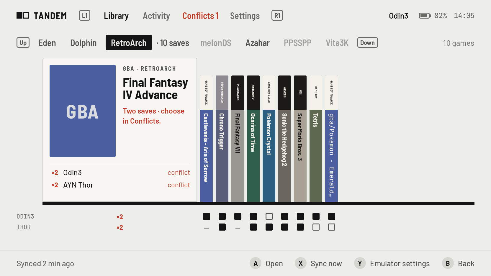
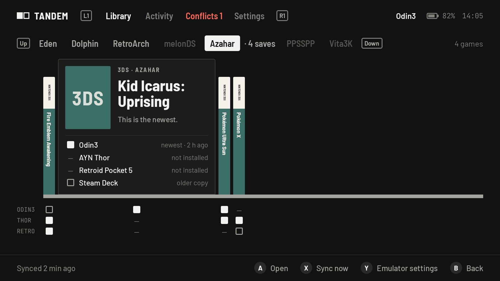

<div align="center">

# Tandem

**Your emulator saves, on every handheld you own.**

A self-hosted server and an Android app that keep saves, save states and emulator settings in step between your
Android handhelds, with a full version history and a web UI to see and settle everything.

[](https://github.com/YoruDev-Ryland/Tandem/releases/latest)
[](https://github.com/YoruDev-Ryland/Tandem/pkgs/container/tandem)
[](https://github.com/YoruDev-Ryland/Tandem/actions/workflows/ci.yml)
[](LICENSE)
[](https://ko-fi.com/rkremeier)



</div>

## Features

- **Play anywhere, continue anywhere.** Save on one handheld, pick it up on another. Tandem notices the save as soon as the
  emulator writes it, sends it to your server, and the server hands it to your other devices.
- **Never writes under a running emulator.** Incoming saves wait until the emulator is closed, and whatever Tandem
  replaces is backed up first.
- **Conflicts you can settle.** When two devices both changed a game, nothing is overwritten. Tandem shows both saves
  side by side, on the device and on the web, and you choose.
- **Every version kept.** The server keeps the last 30 versions of every save and config, so you can roll back a bad
  save or a broken setting.
- **Lost & found.** Deleting a game on the server moves its saves to Lost & found instead of throwing them away, so a
  slip of the finger never costs you a save.
- **Emulator settings too.** Configs are backed up per device and can be copied between devices, with paths and
  device-specific values kept per device.
- **Vault.** Keep BIOS files, firmware and other system files in one place and send them to a device when you set it up.
- **A shelf of your games.** The app and the web UI show your library as a shelf of case spines, real ones where the
  game has them, with each device's sync state under every game.
- **Self-hosted and private.** One container and one data volume. No accounts anywhere but your own server.
- **Keeps itself up to date.** The app installs new releases from GitHub by itself, silently when Shizuku is running.
- **Made for a controller.** Every screen of the app works with the D-pad and face buttons.

## Supported emulators

| Emulator | System | Saves | States | Settings |
| :--- | :--- | :---: | :---: | :---: |
| [RetroArch](https://www.retroarch.com) | Game Boy, GBA, NES, SNES, N64, Genesis, PlayStation and more | ✓ | ✓ | ✓ |
| [Dolphin](https://dolphin-emu.org) | GameCube, Wii | ✓ | ✓ | ✓ |
| [melonDS](https://github.com/rafaelvcaetano/melonDS-android) | Nintendo DS | ✓ | ✓ | ✓ |
| [Azahar](https://azahar-emu.org) | Nintendo 3DS | ✓ | ✓ | ✓ |
| [PPSSPP](https://www.ppsspp.org) | PSP | ✓ | ✓ | ✓ |
| [Eden](https://eden-emu.dev) | Switch | ✓ |  | ✓ |
| [Vita3K](https://vita3k.org) | PS Vita | ✓ |  | ✓ |

Tandem only moves your own save files. It contains no games, BIOS files or keys, and never copies an emulator's keys
or system data off a device.

## How it works

```
 Handheld A ──┐                         ┌── Handheld B
 (Tandem app) │   HTTPS / Tailscale /   │ (Tandem app)
              ├──── LAN ──► Server ◄────┤
 Browser ─────┘  (one Docker container) └── Handheld C
```

The **server** stores every version of every save and config, decides what each device should receive, and serves the
web UI. The **app** runs on each handheld. It watches the emulators' folders through
[Shizuku](https://shizuku.rikka.app), uploads changes, and writes incoming saves into place when the emulator isn't
running. The **web UI** shows your games, devices, conflicts, configs and activity from any browser.

<p align="center">
  
</p>

## Requirements

| | |
| :--- | :--- |
| **Server** | Any machine that runs Docker (x86-64 or ARM64): a NAS, a home server, a Raspberry Pi 4/5 or a small VPS |
| **Handhelds** | Android 13 or newer |
| **Shizuku** | [Shizuku](https://shizuku.rikka.app) on every handheld: Android only lets apps reach other apps' save folders through it |
| **Network** | The handhelds need to reach the server: on your home network, over [Tailscale](https://tailscale.com), or at a domain with HTTPS |

Tested on the AYN Thor and the AYN Odin 3. Any Android 13+ handheld with Shizuku should work; if you try another one,
please [open an issue](https://github.com/YoruDev-Ryland/Tandem/issues) with the result.

## Getting started

### 1. Run the server

Add it to an existing Docker Compose stack:

```yaml
services:
  tandem:
    image: ghcr.io/yorudev-ryland/tandem:latest
    container_name: tandem
    restart: unless-stopped
    environment:
      PUBLIC_URL: https://tandem.example.com   # the address your devices and browser use
    volumes:
      - tandem-data:/data
    ports:
      - "8080:8080"
    cap_drop: [ALL]
    cap_add: [CHOWN, SETUID, SETGID, DAC_OVERRIDE]

volumes:
  tandem-data:
```

or run it on its own:

```sh
docker run -d --name tandem --restart unless-stopped -p 8080:8080 \
  -e PUBLIC_URL=http://192.168.1.10:8080 \
  -v tandem-data:/data \
  ghcr.io/yorudev-ryland/tandem:latest
```

The repository's [`docker-compose.yml`](docker-compose.yml) has every option commented. Images are published for
`linux/amd64` and `linux/arm64`, tagged `latest`, `X.Y` and `X.Y.Z`.

> [!IMPORTANT]
> **The first account to register becomes the admin.** Open the web UI and create your account right after the first
> start, before the server is reachable by anyone else. Or set `ADMIN_EMAIL` so only your address can claim it.

Then decide how your devices will reach it: see [Choosing how devices reach the server](#choosing-how-devices-reach-the-server).

### 2. Install the app on each handheld

1. Download **tandem.apk** from the [latest release](https://github.com/YoruDev-Ryland/Tandem/releases/latest) and open it
   on the handheld. Android asks you to allow installs from your browser or file manager the first time.
2. Install [Shizuku](https://shizuku.rikka.app) and start it. On a rooted device it can start at boot; otherwise start it
   with wireless debugging, and **start it again after every reboot**. Until you do, Tandem can't reach the emulators'
   files and says that Shizuku is off.
3. Open **Tandem**, enter your server's address and sign in, or in the web UI open **Devices → Pair a new device** and
   scan the QR code.
4. Pick the emulators to sync. Tandem finds their save folders itself and shows what it found.
5. Allow notifications, and set Tandem's battery use to **Unrestricted** (Settings → Apps → Tandem → Battery), or Android
   may stop it in the background.

Once you trust the setup, turn on **auto-apply** so incoming saves are written without asking.

### Updates

- **App:** Tandem checks GitHub for a new release a few times a day and installs it when nothing is syncing: silently
  while Shizuku runs, otherwise with Android's usual install prompt. **Settings → Account** shows the version, has
  **Check now**, and can switch automatic installs off.
- **Server:** back up first (see [Backup](#backup)), then `docker compose pull && docker compose up -d`. Database
  migrations run at start-up, and the server snapshots the SQLite database before applying any. Downgrading isn't
  supported.

## Using Tandem

- **Library.** One shelf per emulator. The game under the cursor slides out with its cover and the state of every device:
  newest, older copy, on its way, or a conflict.
- **Conflicts.** When two devices changed the same game, both saves wait in **Conflicts** with when and where each was
  made. Choose one; the other stays in the history.
- **Activity.** What synced, when, from which device, and anything that failed.
- **Web UI.** The same games, plus devices, configs, the Vault, Lost & found, notifications (ntfy, Discord, webhooks),
  backups and account settings.

Tandem never writes into an emulator's files while that emulator is running, and it backs up what it overwrites.

## Choosing how devices reach the server

Devices send a key with every request and the web UI a password. Over plain http on an untrusted network anyone could
read them, and a device key gives full access to the account. Pick one of these:

1. **Tailscale.** Put the server and every device on your tailnet. Plain `http://100.x.y.z:8080` is encrypted end to end
   by WireGuard. For an https address, run `tailscale serve --bg 8080` and use the `https://<machine>.<tailnet>.ts.net`
   name as `PUBLIC_URL`.
2. **A domain behind Caddy, Traefik or nginx** with Let's Encrypt. For a LAN-only server, use a DNS challenge so no
   port has to be open to the internet. Set `PUBLIC_URL` to the https address, `KNOWN_PROXIES` to the proxy's address,
   and publish the container as `127.0.0.1:8080:8080` so the plain port is reachable through the proxy alone.
3. **LAN, plain http.** The easiest, but anyone on the network can read the device key and password. Only on a network
   you fully control.

Behind a proxy, allow large uploads (nginx: `client_max_body_size 0;`) and turn off buffering for live updates on
`/v1/events` (nginx: `proxy_buffering off;`). Caddy needs nothing extra:

```
tandem.example.com {
    reverse_proxy tandem:8080
}
```

Behind **Cloudflare's proxy** as well, list Cloudflare's ranges ([cloudflare.com/ips](https://www.cloudflare.com/ips))
in `KNOWN_PROXIES` next to your proxy's address, so rate limits count each client rather than each Cloudflare edge.
Tandem's live updates send a heartbeat every 25 seconds, well inside Cloudflare's 100-second idle limit; on the free
plan a single upload is capped at 100 MB, which is above every save and state Tandem has met so far.

Run **one replica only**: the locks that keep uploads consistent live inside the server process.

## Server settings

Environment variables. The ASP.NET form (`Tandem__PublicUrl`, ...) is also accepted and takes precedence.

| Variable | Default | Meaning |
| :--- | :--- | :--- |
| `PUBLIC_URL` | none | The address devices and browsers use (pairing links and QR codes). |
| `ALLOW_REGISTRATION` | `false` | Let anyone register. The first account can always register and becomes admin. Admins can change it at runtime. |
| `ADMIN_EMAIL` | none | The first account ever created must use this email. |
| `DATA_DIR` | `/data` | Database (SQLite), files and caches. |
| `PUID` / `PGID` | `1654` | The user and group the server runs as; the entrypoint chowns `/data` to them. |
| `ALLOW_ROOT` | `false` | Needed to run with `PUID=0` or `PGID=0`. |
| `DATABASE_PROVIDER` | `sqlite` | `sqlite` or `postgres`. |
| `DATABASE_CONNECTION` | none | Npgsql connection string for `postgres`; for `sqlite`, an optional database file path. |
| `KNOWN_PROXIES` | none | Comma-separated proxy addresses or networks whose forwarded headers are trusted. |
| `TRUST_FORWARDED_HEADERS` | `false` | Trust forwarded headers from every address. Prefer `KNOWN_PROXIES`. |
| `SERVER_NAME` | `Tandem` | Shown to clients. |
| `SILENT_DEVICE_HOURS` | `72` | A device not seen for this long is flagged in the web UI and notifications. |
| `MIN_FREE_BYTES` | 1 GiB | Free space to keep. Below it, uploads are refused and admins are notified. |
| `TITLE_NAMES` | `true` | Download public Switch, 3DS, GameCube and Wii title lists so games keyed by id show names. `false` keeps the server offline. |
| `ART` | `true` | Fetch cover art and case spines for the games you look at, from libretro-thumbnails and GameTDB, cached up to 500 MB. |

Limits use the ASP.NET form: `Tandem__MaxBlobBytes` (largest file, 8 GiB), `Tandem__MaxUploadBytes` (one web
upload, 8 GiB), `Tandem__AuthRequestsPerMinute` (10) and `Tandem__PruneIntervalMinutes` (60). Save states are large
(5 to 100 MB each), so size the volume for many versions of them.

### Admin commands

```sh
docker exec tandem list-users
docker exec tandem create-user me@example.com --admin   # prints the generated password
docker exec tandem reset-password me@example.com        # prints the new password
docker exec tandem revoke-device <deviceId>
```

## Backup

In the web UI (admin), set a target and a schedule: a mounted folder (a NAS) or an S3 bucket, daily at an hour (UTC),
and how many backups to keep. A backup holds the database and every stored file, including Lost & found. You can
encrypt backups with a passphrase.

- Emulator config secrets (RetroArch achievements and netplay credentials, the Eden web token) and notification tokens
  are stored on the server and are part of a backup. Turn encryption on if the backup target isn't private.
- **Losing the passphrase means the backup can't be restored.** Keep it somewhere other than the server.

To restore, stop the server and restore into an empty data volume, as `PUID:PGID`:

```sh
docker stop tandem
docker run --rm -v tandem-data:/data --user 1654:1654 -e TANDEM_BACKUP_PASSPHRASE \
  ghcr.io/yorudev-ryland/tandem:latest restore-backup /data/tandem-backup-20261120-030000.tar.gz.enc
docker start tandem
```

Restore refuses to run on a server that already has accounts or files.

## Troubleshooting

| Problem | What to do |
| :--- | :--- |
| The app says **Shizuku is off** | Start Shizuku again (it stops at every reboot unless the device is rooted), then reopen Tandem. |
| Saves stop syncing in the background | Set Tandem's battery use to **Unrestricted** and allow its notification. |
| A game shows up twice | Two different file names (for example `Game (USA)` and `Game`) are two games to Tandem. Keep the file the emulator uses, remove the other from the device, then delete the extra game on the web. Its saves go to Lost & found. |
| A save didn't arrive | Incoming saves wait while that emulator is running. Close the emulator, or check **Activity** for what's waiting. |
| *storage_full* errors | The server's disk is below `MIN_FREE_BYTES`. Free space or grow the volume. |
| Pairing QR code points to the wrong address | Set `PUBLIC_URL` to the address the devices use, and `KNOWN_PROXIES` when behind a proxy. |
| No cover art | Art is fetched when a game is shown. Check that the server can reach the internet and that `ART` isn't `false`. |

## Building from source

Everything needed to build the server image and the app is in this repository.

| Part | Path | Stack |
| :--- | :--- | :--- |
| Server | [`src/`](src), [`tests/`](tests) | ASP.NET Core (.NET 10), EF Core with SQLite or Postgres |
| Web UI | [`web/`](web) | Svelte 5, Vite, Vitest |
| Android app | [`android/`](android) | Kotlin, Jetpack Compose, Robolectric |

**Server image** (builds the web UI too):

```sh
docker build -t tandem .
```

**Server and web for development** (.NET 10 SDK and Node 22):

```sh
dotnet test Tandem.slnx
npm --prefix web ci && npm --prefix web test && npm --prefix web run check
npm --prefix web run dev     # http://localhost:5173, proxies /v1 to a server on http://localhost:5100
```

**Android app** (JDK 21 and the Android SDK):

```sh
cd android
./gradlew testDebugUnitTest assembleDebug     # app/build/outputs/apk/debug/app-debug.apk
./gradlew assembleRelease                     # needs a signing key, see below
```

Release builds are signed with `android/keystore.properties` when it exists; `android/scripts/make-release-key.sh`
creates a key outside the repository and writes that file (never committed). An app you build yourself is signed with
your own key, so it can't update over a release from this repository, and the in-app updater (which only installs
APKs signed with the installed app's key) leaves it alone. To point the updater at your own fork, build with
`TANDEM_UPDATE_REPO=you/Tandem`.

**Releases** are made by pushing a `vX.Y.Z` tag: [`release.yml`](.github/workflows/release.yml) publishes the
multi-arch image to `ghcr.io` and attaches the signed `tandem.apk` and its SHA-256 to the GitHub release. It needs the
repository secrets `ANDROID_KEYSTORE_BASE64`, `ANDROID_KEYSTORE_PASSWORD`, `ANDROID_KEY_ALIAS` and
`ANDROID_KEY_PASSWORD`.

The API is described at `GET /v1/openapi.json` (send the header `Tandem-Protocol: 1`, as with every `/v1/` route).

## Security

Please report security problems privately through
[GitHub's security advisories](https://github.com/YoruDev-Ryland/Tandem/security/advisories/new), not in a public
issue. See [SECURITY.md](SECURITY.md).

## Credits

Tandem stands on the work of the emulator projects it syncs, and of:

- [**Shizuku**](https://github.com/RikkaApps/Shizuku), which lets the app reach emulator folders without root.
- [**libretro-thumbnails**](https://github.com/libretro-thumbnails) and [**GameTDB**](https://www.gametdb.com) for cover
  art and case scans, fetched at runtime and cached only on your own server.
- [**titledb**](https://github.com/blawar/titledb) and [**3dsdb**](https://github.com/hax0kartik/3dsdb) for game names.
- [**SkiaSharp**](https://github.com/mono/SkiaSharp) for cutting case spines.
- The **Barlow** and **JetBrains Mono** typefaces (SIL Open Font License).

Cover art and case scans belong to their publishers and are never bundled or redistributed. Full third-party details
are in [`THIRD_PARTY_NOTICES.md`](THIRD_PARTY_NOTICES.md).

## Support

Tandem is free and open source. If it saves you a save, you can support its development on
[Ko-fi](https://ko-fi.com/rkremeier).

## License

[GPL-3.0](LICENSE). Third-party components keep their own licenses; see [`THIRD_PARTY_NOTICES.md`](THIRD_PARTY_NOTICES.md).
